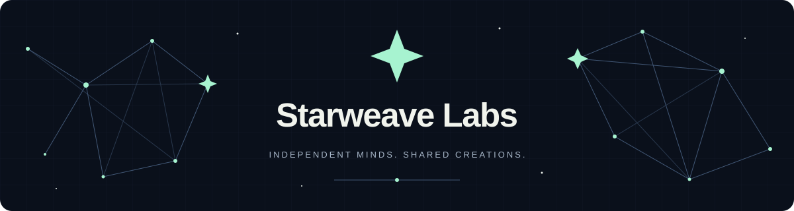

  

  <h1>星织实验室 · Starweave Labs</h1>
  
<strong>汇聚灵感，共织作品。</strong>

  
A collaborative lab weaving ideas into meaningful projects.

---

## 每一颗星，都有自己的光

星织实验室是一个面向开源与实用创造的共创空间。我们希望让不同的经验、视角与灵感相遇，把值得解决的问题，逐步织成可以使用、复用和继续完善的作品。

**这里的品牌属于共同创造，而不是某一个人。** 不必拥有相同的背景，也不必从一个宏大的计划开始；一个清晰的问题、一段好用的代码、一份认真整理的文档，都可以成为起点。

- **伙伴平等**：尊重彼此的贡献与判断，让不同的视角进入讨论。
- **过程开放**：用清楚的 Issue、文档和代码评审，让想法与决策有迹可循。
- **认真完成**：小步验证，持续打磨；不仅关注实现，也关注使用体验与维护。

## 我们希望一起探索

| 方向 | 想要解决的问题 |
| --- | --- |
| **产品界面** | 让组件、设计系统与页面体验更一致、更可访问，也更容易复用。 |
| **开发工具** | 减少重复工作，让搭建、集成与交付流程更清晰、更可靠。 |
| **AI 协作** | 探索人与 AI 共同创作的工具链，让能力可理解、过程可检查、结果可维护。 |

这些是共创的探索方向，不是已经完成的项目清单。具体范围与进展，以各项目仓库的说明为准。

## 从真实作品开始

### ZUVI

**面向 React 19 的现代组件库与产品界面工具集。**

以设计令牌、原生 CSS 与无障碍优先为核心，连接组件、页面搭建和面向 AI 协作的工具链。

[查看源码](https://github.com/yeyouyuan/zuvi) · [在线文档与演示](https://yeyouyuan.github.io/zuvi/) · [提出问题](https://github.com/yeyouyuan/zuvi/issues)

> **关联项目 · 仓库暂未迁入。** ZUVI 当前仍位于 `yeyouyuan/zuvi`，文档、发行与安装方式以现有仓库为准。组织的建立不改变项目归属或发布配置。

## 一起织出下一件作品

代码、文档、设计、测试与真实使用反馈，都可以成为有价值的贡献。

1. **带着问题来**：描述你的场景、遇到的困难，以及希望改善的结果。
2. **一起讨论**：在相应项目的 Issue 中对齐范围；较大的改动，先讨论再动手。
3. **小步共创**：提交一个可检查的 PR，补充必要的说明与验证，再通过评审继续完善。

关于实验室定位与共创方向的建议，可以在[组织介绍仓库的 Issues](https://github.com/Starweave-Labs/.github/issues) 中交流；关于 ZUVI 的需求或问题，请前往 [ZUVI Issues](https://github.com/yeyouyuan/zuvi/issues)。仓库访问与成员权限由维护者按具体协作需要安排。

---

  
<strong>让灵感相遇，让作品生长。</strong>

  
Independent minds. Shared creations.

  
每个项目的使用方式、贡献约定与许可，以其各自仓库为准。

